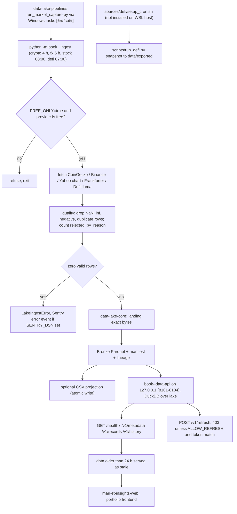
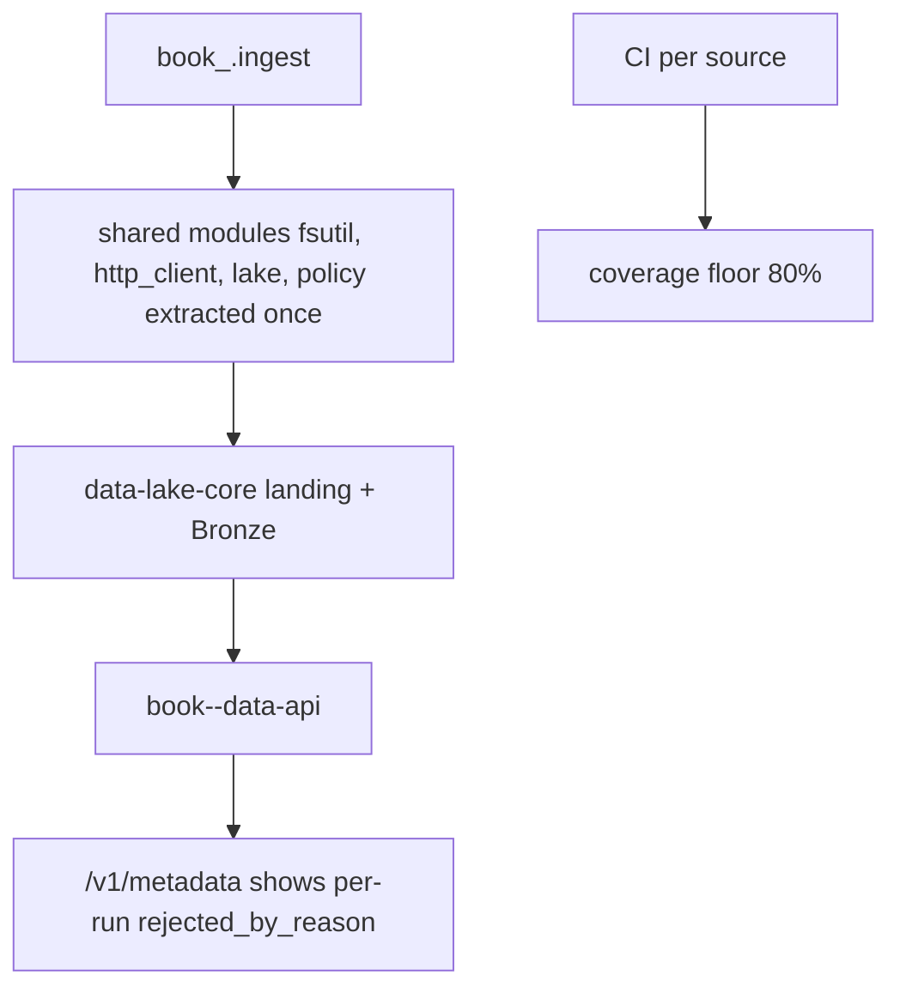

# 01 — Business process (As-Is / To-Be)

market-data รวม data product ตลาดแบบ free-only สี่ตัว (crypto, stock, fx, defi) ที่ดึง API สาธารณะ เขียน bytes จริงและ Bronze Parquet ลง shared lake แล้วให้ API แบบอ่านอย่างเดียวบน loopback สำหรับ market-insights-web และ portfolio dashboard

Last reviewed: 2026-11-28 · commit `63fe85f`

## As-Is (จากโค้ดวันนี้)

Sources: `sources/crypto/src/book_crypto/ingest.py`, `sources/crypto/src/book_crypto/api.py`, `sources/crypto/src/book_crypto/lake.py`, `sources/crypto/src/book_crypto/quality.py`, `sources/defi/scripts/run_defi.py`, `sources/defi/setup_cron.sh`, `.github/workflows/ci.yml`, `PRODUCT.md`, `README.md`

ข้อเท็จจริงจากโค้ดและเอกสาร:

- ทั้งสี่ source ใช้โครงเดียวกัน (`ingest.py`, `lake.py`, `api.py`, `policy.py`, `quality.py`) และยังคัดลอกโมดูลร่วมซ้ำต่อ source (`README.md` §History)
- ตัว scheduler อยู่นอก repo นี้; ว่า Windows tasks ติดตั้งและรันอยู่หรือไม่ ยืนยันไม่ได้จาก repo [ต้องยืนยัน]
- ไม่มี hosted deployment; Sentry DSN ยังไม่ได้ตั้งให้ product เหล่านี้ (`PRODUCT.md`) [ต้องยืนยัน]

## To-Be (`README.md` §History, `sources/*/docs/UPGRADE-PLAN.md` §Backlog, `.github/workflows/ci.yml` comment)

Sources: `README.md`, `sources/crypto/docs/UPGRADE-PLAN.md`, `sources/stock/docs/UPGRADE-PLAN.md`, `sources/fx/docs/UPGRADE-PLAN.md`, `sources/defi/docs/UPGRADE-PLAN.md`, `.github/workflows/ci.yml`

## Gap

| ID | As-Is → To-Be | Status | Owner | Evidence |
|---|---|---|---|---|
| G1 | `fsutil`, `http_client`, `lake`, `policy` คัดลอกซ้ำในแต่ละ source → แยกเป็นโมดูลร่วม | todo | claude | `README.md` §History ("extracting them is the next step") |
| G2 | `rejected_by_reason` อยู่ใน stdout และ landing metadata เท่านั้น → แสดงใน `/v1/metadata` | todo | claude | `sources/*/docs/UPGRADE-PLAN.md` P2; ไม่พบใน `sources/*/src/*/api.py` |
| G3 | coverage gate 76–79% → พื้น 80% | todo | claude | `.github/workflows/ci.yml` ("the 80% floor is an open follow-up") |
| G4 | ไม่มี extra `dev` และ `[build-system]` → มีครบ | done | claude | `sources/*/pyproject.toml` (`dev = [`, `[build-system]`) |
| G5 | crypto trending ไม่ตรวจรูปแบบ `coins[].item` → validate payload ก่อน | todo | claude | `sources/crypto/docs/UPGRADE-PLAN.md` P1 |
| G6 | defi `apy`/`tvlUsd` ที่เป็น string อาจทำให้ format พัง → coerce เป็น float ใน `filter_pools` | todo | claude | `sources/defi/docs/UPGRADE-PLAN.md` P1 |
| G7 | defi ไม่บันทึกจำนวน pool ที่แต่ละ filter ตัด → บันทึกใน landing metadata | todo | claude | `sources/defi/docs/UPGRADE-PLAN.md` P2 |
| G8 | ไม่มีกำหนดการที่ยืนยันได้และไม่มี hosted job → owner ตัดสินว่ารันที่ไหน | decide | owner | `PRODUCT.md` §Runtime status ([ต้องยืนยัน] Windows tasks, ไม่มี hosted deployment) |

## Open questions

- `sources/crypto/archive/` ยังจำเป็นหรือไม่ (`sources/crypto/docs/UPGRADE-PLAN.md` P2)
- ต้องการ Sentry DSN สำหรับ ingest runs หรือไม่
